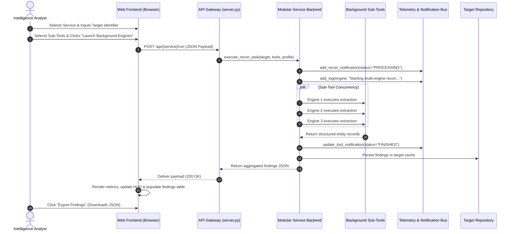

# Oasis Intelligence & Reconnaissance Platform — Complete OSINT Tools Manual

## 1. Architectural Overview & Execution Model

The **Oasis** platform is structured around a decoupled, modular reconnaissance and data extraction architecture. Rather than relying on rigid monolithic scripts, Oasis distributes workloads across **12 specialized capability domains**, each backed by dedicated, concurrent **background tool engines** (totaling 36 modular engines).

```
                               ┌────────────────────────────────────────┐
                               │   Oasis Command Gateway (server.py)    │
                               │   FastAPI / ASGI Event Dispatcher      │
                               └──────────────────┬─────────────────────┘
                                                  │
                 ┌────────────────────────────────┴──────────────────────────────┐
                 ▼                                                               ▼
  ┌──────────────────────────────┐                              ┌──────────────────────────────┐
  │  Social Media Intelligence   │                              │ Reconnaissance & Footprint   │
  │  4 Services / 12 Sub-tools   │                              │ 8 Services / 24 Sub-tools    │
  └──────────────┬───────────────┘                              └──────────────┬───────────────┘
                 │                                                             │
                 ├─ Instagram Scraping & Recon                                 ├─ Website URL Search & Recon
                 ├─ LinkedIn Workforce Recon                                   ├─ Web Browsers & Stack Recon
                 ├─ X (Twitter) Scraping                                       ├─ Email Address Intelligence
                 └─ Reddit Community Recon                                     ├─ IP & ASN Geolocation
                                                                               ├─ Username Identity Recon
                                                                               ├─ Phone Number & Carrier Recon
                                                                               ├─ Hostname & Subdomain Recon
                                                                               └─ Bitcoin & Crypto Intelligence
```

### Background Execution & Telemetry Pipeline
1. **Request Ingestion**: The analyst specifies target parameters (domain, IP, handle, email, wallet, or phone) and selects which background engines to engage.
2. **Thread Dispatching**: The service backend launches asynchronous worker threads corresponding to the chosen sub-tools.
3. **Telemetry Logging**: Every engine emits real-time status updates and diagnostic logs to the `core.logger` FIFO ring buffer, immediately viewable in the **Live Telemetry Stream (`/terminal`)**.
4. **Event Notification**: Task progress (`PROCESSING` &rarr; `FINISHED`) is registered in `core.notifications`, dynamically updating badge counters and HUD progress indicators.
5. **Dossier Compilation & Vault Sync**: Structured intelligence entities are aggregated, normalized, rendered in interactive data tables, and persisted in the **Target Vault (`/vault`)**.

---

## 2. Social Media Intelligence & Scraping Engines

---

### Service 1: Instagram Intelligence & Scraping (`social_instagram`)
* **Service Route**: `/services/social-instagram`
* **Target Inputs**: Username handle (e.g., `@target_user`) or profile URL.
* **Scope**: Public profile extraction, social graph correlation, media cataloging.

#### Sub-Tools & Working Procedures:

| Sub-Tool | Engine ID | Working Procedure & Functioning | Intelligence Value |
| :--- | :--- | :--- | :--- |
| **Profile Scraper** | `profile_scraper` | Connects to public endpoints and parses serialized JSON state and OpenGraph headers. Extracts biographical text, business category tags, external hyperlinked URLs, verification badges, and follower/following counts. | Baseline subject identity, primary contact vectors, verification status. |
| **Relationship Analyzer** | `relationship_analyzer` | Traverses public follower/following lists and post mention tags. Evaluates mutual connection clusters, tagging frequency, engagement velocity, and cross-profile interaction patterns to graph influence networks. | Social hierarchy mapping, high-interaction affiliates, mutual node discovery. |
| **Media Harvester** | `media_harvester` | Iterates over public media nodes. Extracts image/video CDN links, publication timestamps, location geotag IDs, caption text, and comment hashtags. Analyzes temporal posting habits. | Geolocation patterns, operational schedules, recurring campaign hashtags. |

---

### Service 2: LinkedIn Workforce Reconnaissance (`social_linkedin`)
* **Service Route**: `/services/social-linkedin`
* **Target Inputs**: Person name, corporate identity, or organization handle.
* **Scope**: Corporate footprinting, organizational structure mapping, career verification.

#### Sub-Tools & Working Procedures:

| Sub-Tool | Engine ID | Working Procedure & Functioning | Intelligence Value |
| :--- | :--- | :--- | :--- |
| **Profile Recon Engine** | `profile_recon` | Parses publicly indexed profile data, extracting job titles, employment chronologies, academic backgrounds, credential certifications, and stated skill sets. | Subject career timeline, technical proficiencies, educational validation. |
| **Company Intelligence** | `company_intelligence` | Aggregates corporate overview data including registered headquarters, international branch locations, declared headcount ranges, industry classifications, and corporate web properties. | Corporate scale assessment, physical footprint discovery, legal entity names. |
| **Workforce Mapper** | `workforce_mapper` | Evaluates public employee distributions across departments (e.g., Engineering, Legal, Operations, Executive). Detects talent departure timelines and organizational reporting structures. | Key personnel identification, organizational hierarchy, talent churn indicators. |

---

### Service 3: X (Twitter) Timeline Scraping & Recon (`social_x`)
* **Service Route**: `/services/social-x`
* **Target Inputs**: Handle (e.g., `@handle`) or topic hashtag.
* **Scope**: Timeline intelligence, sentiment profiling, client source attribution.

#### Sub-Tools & Working Procedures:

| Sub-Tool | Engine ID | Working Procedure & Functioning | Intelligence Value |
| :--- | :--- | :--- | :--- |
| **Tweet Harvester** | `tweet_harvester` | Indexes public timeline posts, replies, quote-tweets, and reposts. Extracts outbound URL citations, multimedia attachments, and mention arrays. | Active narrative tracking, external resource references, discourse patterns. |
| **Handle Analyzer** | `handle_analyzer` | Queries account metadata to extract numerical snowflake IDs, creation date/time, badge flags, and client applications used to publish tweets (e.g., Web, iOS, Android, third-party APIs). | Account age verification, automation bot detection, operational device footprints. |
| **Sentiment & Frequency Tracker** | `sentiment_tracker` | Calculates posting velocity curves across hours of the day and days of the week. Analyzes lexical keyword frequencies and sentiment polarity scores. | Target operational timezone estimation, narrative sentiment trends. |

---

### Service 4: Reddit Community Reconnaissance (`social_reddit`)
* **Service Route**: `/services/social-reddit`
* **Target Inputs**: Subreddit name (`r/community`) or username (`u/user`).
* **Scope**: Community indexing, user submission archiving, discussion scraping.

#### Sub-Tools & Working Procedures:

| Sub-Tool | Engine ID | Working Procedure & Functioning | Intelligence Value |
| :--- | :--- | :--- | :--- |
| **Subreddit Crawler** | `subreddit_crawler` | Queries community endpoints to index subreddit sidebar rules, submission policies, subscriber count trajectories, and the active public moderator roster. | Community governance analysis, key authority accounts, topic boundaries. |
| **User Dossier Builder** | `user_dossier` | Aggregates public submission and comment histories. Breaks down post and comment karma distributions across individual subreddits to map subject interest domains. | Psychological/interest profiling, active community participation footprints. |
| **Thread Extractor** | `thread_extractor` | Parses discussion threads and comment trees. Identifies shared code snippets, external document links, top-voted perspectives, and recurring participant accounts. | Discourse extraction, technical payload discovery, collaborative discussion nodes. |

---

## 3. Reconnaissance & Footprinting Engines

---

### Service 5: Website URL Search & Deep Crawl (`recon_website_url`)
* **Service Route**: `/services/recon-website-url`
* **Target Inputs**: Fully qualified domain name or URL (e.g., `https://example.com`).
* **Scope**: Web surface crawling, API endpoint extraction, passive secret discovery.

#### Sub-Tools & Working Procedures:

| Sub-Tool | Engine ID | Working Procedure & Functioning | Intelligence Value |
| :--- | :--- | :--- | :--- |
| **Deep Web Crawler** | `deep_crawler` | Spiders the target domain recursively up to configurable depth limits. Catalogs internal links, external domain references, anchor paths, and downloadable document assets (PDFs, docs). | Complete web sitemap, external dependencies, referenced document assets. |
| **Endpoint & API Extractor** | `endpoint_extractor` | Parses inline and external JavaScript bundles, extracting AJAX requests, REST API route templates (`/api/v1/...`), query parameters, and hidden administrative routes. | Attack surface definition, undocumented API endpoints, parameters for testing. |
| **Secret & Token Detector** | `secret_detector` | Applies regex heuristics across HTML comments and scripts to passively identify exposed credentials, AWS access keys, staging URLs, and hardcoded Bearer tokens. | Vulnerability discovery, credential leak exposure, non-public environment leaks. |

---

### Service 6: Web Footprint & Browser Recon (`recon_web_browsers`)
* **Service Route**: `/services/recon-web-browsers`
* **Target Inputs**: Web application URL or host.
* **Scope**: Headless DOM auditing, tech stack fingerprinting, header compliance.

#### Sub-Tools & Working Procedures:

| Sub-Tool | Engine ID | Working Procedure & Functioning | Intelligence Value |
| :--- | :--- | :--- | :--- |
| **Headless Browser Auditor** | `headless_analyzer` | Executes a headless browser session to simulate client page execution. Captures post-render DOM structures, runtime client-side JavaScript redirects, and console errors. | Single-page application rendering, dynamic redirect mapping, runtime errors. |
| **Tech Stack Fingerprinter** | `tech_fingerprinter` | Analyzes HTTP response headers, meta tags, and script path hashes. Matches signatures for web servers (Nginx, Apache), frontend frameworks (React, Vue), CMSs (WordPress), and CDNs. | Technology stack versioning, known vulnerability profiling, hosting architecture. |
| **DOM & Header Inspector** | `dom_inspector` | Inspects HTTP security headers (`Content-Security-Policy`, `HSTS`, `X-Frame-Options`, `CORS`). Analyzes form inputs, password fields, and cookie flags (`HttpOnly`, `Secure`, `SameSite`). | Defense posture evaluation, misconfiguration detection, cookie security posture. |

---

### Service 7: Email Scraping & Verification (`recon_email`)
* **Service Route**: `/services/recon-email`
* **Target Inputs**: Email address (e.g., `analyst@domain.com`) or domain name.
* **Scope**: Breach exposure cross-referencing, SMTP routing validation, pattern discovery.

#### Sub-Tools & Working Procedures:

| Sub-Tool | Engine ID | Working Procedure & Functioning | Intelligence Value |
| :--- | :--- | :--- | :--- |
| **Breach & Leak Scanner** | `breach_scanner` | Queries publicly available breach disclosures, dump indexes, and paste archives for past credential exposures associated with the specified email or domain. | Account compromise risk, credential reuse indicators, past exposure records. |
| **SMTP & MX Validator** | `smtp_validator` | Resolves authoritative DNS MX records and initiates an SMTP handshake without sending an email. Tests for catch-all status, mailbox existence, and SPF/DKIM policy validity. | Active deliverability confirmation, email server topology, spoofing resilience. |
| **Domain Mail Finder** | `domain_mail_finder` | Scrapes public web resources to discover email naming conventions for an enterprise (e.g., `first.last@`, `flast@`) and compiles staff directory addresses. | Organizational email conventions, discovered personnel addresses. |

---

### Service 8: IP Address Intelligence & Geolocation (`recon_ip`)
* **Service Route**: `/services/recon-ip`
* **Target Inputs**: IPv4, IPv6 address, or CIDR network block.
* **Scope**: Geolocation resolution, BGP routing analysis, reverse DNS pointer discovery.

#### Sub-Tools & Working Procedures:

| Sub-Tool | Engine ID | Working Procedure & Functioning | Intelligence Value |
| :--- | :--- | :--- | :--- |
| **GeoIP Locator** | `geoip_locator` | Queries Regional Internet Registry (RIR) databases and IP geolocation mapping data. Resolves geographic coordinates, country, region, city, ISP name, and timezone. | Physical server location, network service provider, jurisdiction analysis. |
| **ASN & BGP Enumerator** | `asn_enumerator` | Resolves the Autonomous System Number (ASN), BGP network prefix, upstream transit routing partners, and registered owning organization. | Infrastructure ownership, peering topology, DDoS protection provider (Cloudflare, Akamai). |
| **Reverse DNS & SSL Pointer** | `reverse_dns` | Performs PTR queries for the IP address. Evaluates virtual host sharing and pulls Subject Alternative Names (SANs) from active TLS certificates on port 443. | Co-hosted domains on the same server, shared hosting discovery, server naming. |

---

### Service 9: Username Reconnaissance & Identity (`recon_username`)
* **Service Route**: `/services/recon-username`
* **Target Inputs**: Username or alias handle (e.g., `target_handle`).
* **Scope**: Cross-platform registration enumeration, profile dossier extraction, alias linking.

#### Sub-Tools & Working Procedures:

| Sub-Tool | Engine ID | Working Procedure & Functioning | Intelligence Value |
| :--- | :--- | :--- | :--- |
| **Cross-Platform Scanner** | `cross_platform_scanner` | Concurrently checks registration availability and HTTP status codes across 100+ public platforms (GitHub, GitLab, Medium, Steam, DockerHub, Dev.to, etc.). | Digital footprint extent, developer platforms, gaming and blogging accounts. |
| **Account Profile Enumerator** | `account_enumerator` | Scrapes biographical details, website links, joined dates, and avatar image checksums from confirmed accounts to correlate identity ownership across services. | Cross-platform identity verification, consistent avatar/bio fingerprints. |
| **Alias Correlator** | `alias_correlator` | Generates leetspeak variants, numerical suffixes, and mapped email prefix hypotheses based on target patterns to detect alternative operational handles. | Identity expansion, evasion handle detection, linked email discovery. |

---

### Service 10: Phone Number Recon & Carrier Intelligence (`recon_phone`)
* **Service Route**: `/services/recon-phone`
* **Target Inputs**: International telephone number in E.164 format (e.g., `+14155552671`).
* **Scope**: Telecommunications carrier identification, line type validation, routing verification.

#### Sub-Tools & Working Procedures:

| Sub-Tool | Engine ID | Working Procedure & Functioning | Intelligence Value |
| :--- | :--- | :--- | :--- |
| **Carrier & Telco Lookup** | `carrier_lookup` | Queries global telecommunications databases to extract the operating carrier name, MCC (Mobile Country Code), and MNC (Mobile Network Code). | Service provider identification, original vs ported telco determination. |
| **HLR Network Validator** | `hlr_validator` | Queries Home Location Register indicators to verify whether the number is currently provisioned, active on a cellular network, or internationally roaming. | Active subscriber verification, temporary burn/decommissioned detection. |
| **Line Type & Format Detector** | `line_type_detector` | Validates international format correctness against ITU-T standards and classifies line type as Mobile, Landline, VoIP, or Toll-Free. | Identification of disposable virtual numbers (VoIP) vs physical SIM cards. |

---

### Service 11: Hostname & Subdomain Reconnaissance (`recon_subdomains`)
* **Service Route**: `/services/recon-subdomains`
* **Target Inputs**: Root domain (e.g., `enterprise-target.com`).
* **Scope**: DNS bruteforcing, Certificate Transparency logs, DNS record enumeration.

#### Sub-Tools & Working Procedures:

| Sub-Tool | Engine ID | Working Procedure & Functioning | Intelligence Value |
| :--- | :--- | :--- | :--- |
| **DNS Bruteforce Resolver** | `dns_bruteforce` | Executes high-speed concurrent DNS lookups against curated dictionary wordlists to uncover unlinked subdomains (`vpn.`, `dev.`, `api.`, `mail.`). | Discovery of hidden subdomains, staging infrastructure, internal gateways. |
| **Certificate Transparency Indexer** | `certificate_transparency` | Queries public Certificate Transparency (CT) repositories (such as crt.sh) to identify historical and current SSL/TLS certificates issued for the target domain and its subdomains. | Complete inventory of every host that has ever had a public TLS certificate. |
| **Zone & Record Enumerator** | `zone_enumerator` | Queries authoritative nameservers for DNS record types: `A`, `AAAA`, `CNAME`, `MX`, `NS`, `TXT`, and `SPF`. Detects dangling CNAMEs for subdomain takeover risk. | DNS architecture mapping, third-party SaaS dependency discovery (Mailgun, AWS, Zendesk). |

---

### Service 12: Bitcoin & Crypto Address Intelligence (`recon_crypto`)
* **Service Route**: `/services/recon-crypto`
* **Target Inputs**: Bitcoin (BTC) or cryptocurrency wallet address.
* **Scope**: Blockchain transaction tracking, wallet balance telemetry, counterparty flow analysis.

#### Sub-Tools & Working Procedures:

| Sub-Tool | Engine ID | Working Procedure & Functioning | Intelligence Value |
| :--- | :--- | :--- | :--- |
| **Blockchain Explorer** | `blockchain_explorer` | Queries distributed public ledgers to extract current confirmed balance, total received, total sent, unconfirmed transaction inputs, and transaction volume. | Financial capacity estimation, wallet activity status, transaction volume. |
| **Wallet Risk Profiler** | `wallet_profiler` | Evaluates wallet address categorization against public heuristic databases to detect affiliations with known exchanges, sanctions lists, darknet markets, or ransomware campaigns. | Risk score classification, known service attribution, compliance risk flags. |
| **Transaction Flow Grapher** | `transaction_flow` | Maps historical inflow and outflow transactions, analyzing counterparty addresses, UTXO consolidation patterns, and hop distances to identify fund movement. | Financial trail visualization, withdrawal endpoints, mixer/tumbler usage detection. |

---

## 4. Core System & Infrastructure Services

| Service | Route | Description & Working Mechanism |
| :--- | :--- | :--- |
| **Mission Briefing Dashboard** | `/dashboard` | Central operational HUD providing aggregate KPI metrics (Indexed Targets, Extracted Assets, Crawl Efficiency, Active Engines), interactive launch tiles, and quick status controls. |
| **Target Intelligence Vault** | `/vault` | Centralized secure repository consolidating all harvested records across the 12 services with categorized search, timestamps, and direct service redirection links. |
| **Live Telemetry Terminal** | `/terminal` | Real-time streaming console buffer connected to the in-memory circular ring buffer. Displays sub-second execution logs with timestamp, engine source tag, and severity levels. |
| **Processing Notifications** | `/notifications` | Live event stream tracking active, processing, and finished recon tasks across all engines with filtering by status and tool category. |
| **System Environment Settings** | `/settings` | Displays platform configuration, active gateway network port (`5050`), modular service root directory paths, and concurrency parameters. |

---

## 5. End-to-End Operational Workflow

The sequence below illustrates how an extraction request propagates through the platform:



---

## 6. Defensive Use, Compliance & Security Considerations

All tools and background engines within the Oasis platform are designed strictly for **authorized defensive security assessments, penetration testing reconnaissance, open-source intelligence research, and threat surface auditing**:

1. **Passive First**: Engines prioritize publicly accessible, non-intrusive metadata sources (DNS records, Certificate Transparency logs, HTTP headers, public blockchain ledgers).
2. **Safe Handshakes**: Network verification tools (such as SMTP validators) initiate standard diagnostic handshakes and disconnect cleanly without transmitting unauthorized payloads.
3. **Auditability**: Every action initiated across all 12 services generates a persistent log record in the Live Telemetry stream with exact timestamps and source tags.
4. **Data Isolation**: All collected intelligence is maintained locally within the deployment environment, ensuring sensitive investigation data is not transmitted to external third-party aggregators.

